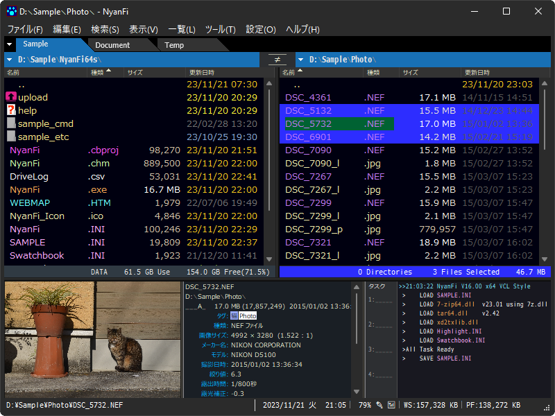

# NyanFi_x64s

## 概要

キーボード操作主体の2画面ファイラーです(マウス操作も可能)。  
Windows 7 ～ Windows 11 で動作します。  

これは、64ビット従来版 V15.63 をベースに作成した、ライト/ダークモード表示可能なVCLスタイル版です。  
INIファイルなどは、従来版のものを流用できます。  

[スクリーンショット](doc/screenshot.md)

## 開発環境

C++Builder 12.1 (BCC64)

## 補足

http://nekomimi.la.coocan.jp/ で、試験公開・動作未保証版を公開しています。  
VCLスタイル版をベースに、AI(Codex)を活用して、古い記述や不適切な箇所の修正、動作の改善・高速化を行いました。コードは、AIによる生成に依存しています。  
病気のため、サポートは行えません。ご利用は自己責任でお願いいたします。
